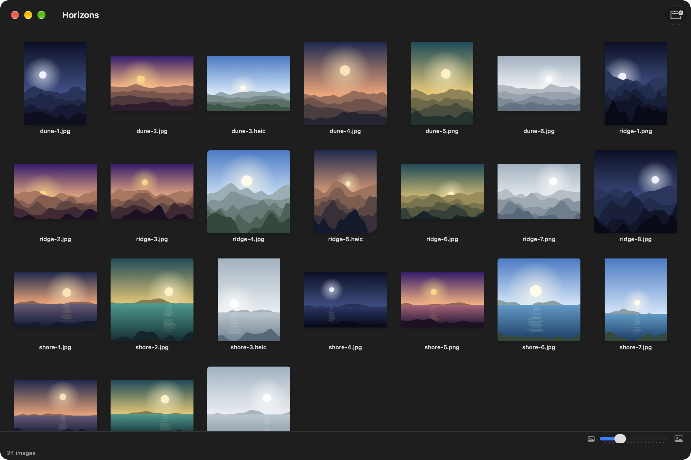
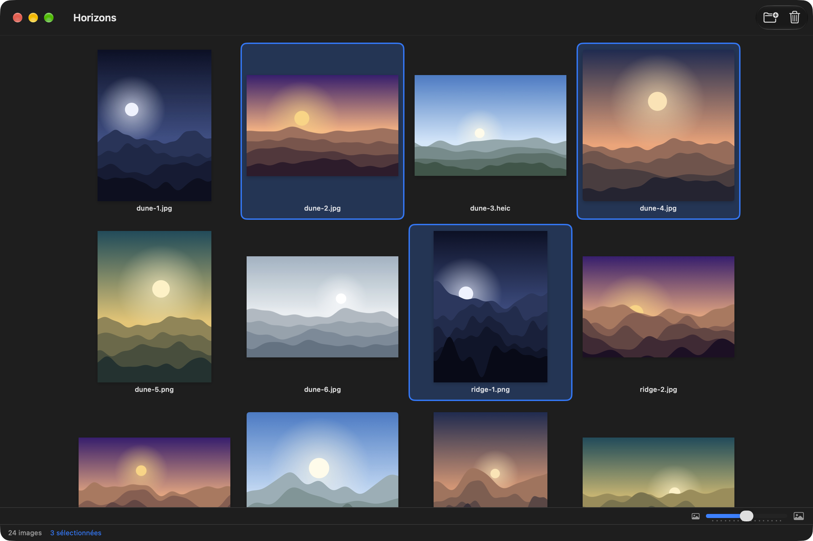
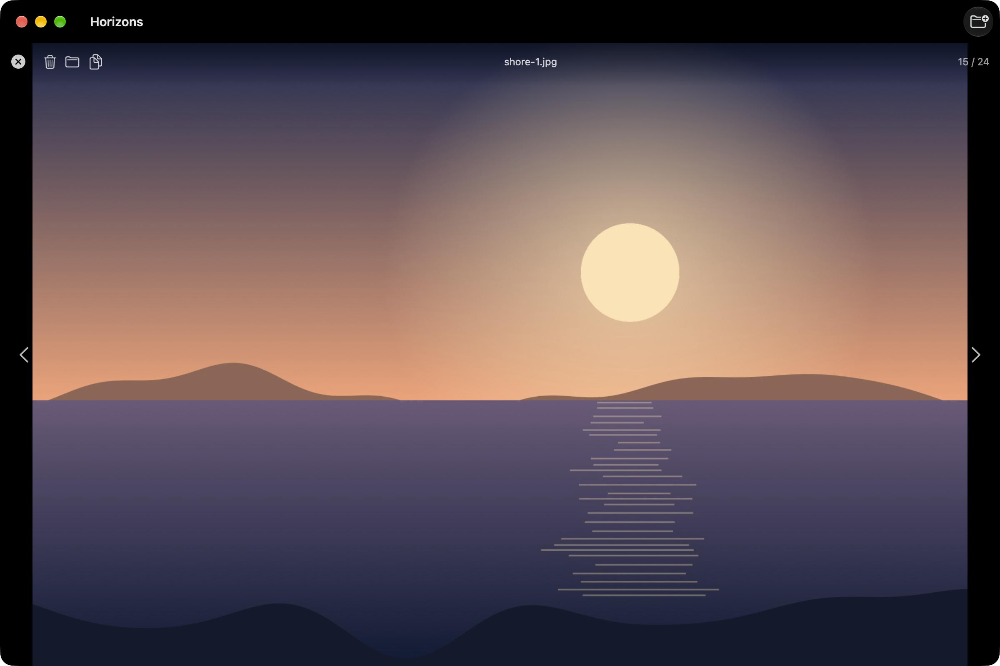
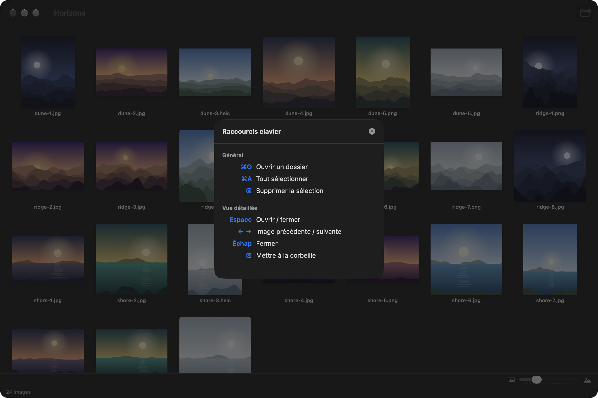

# Planche

[](https://github.com/gwenn-ha-dev/Planche/actions/workflows/ci.yml)
[](./LICENSE)


*🇬🇧 [English](./README.md) · 🇫🇷 Français*

App macOS native pour visualiser, trier et organiser vos images — une planche-contact pour une arborescence de dossiers.



## Fonctionnalités

- **Parcours récursif** : toutes les images d'un dossier et de ses sous-dossiers, dans l'ordre naturel (`shore-2` avant `shore-10`).
- **Galerie de miniatures** à taille réglable, mémorisée entre les sessions.
- **Vue détaillée** avec navigation au clavier : ← → pour passer d'une image à l'autre, Espace ou Échap pour revenir.
- **Sélection multiple** : ⌘-clic, ⇧-clic, ⌘A.
- **Suppression** vers la corbeille macOS, **glisser-déposer** d'un dossier dans la fenêtre, **Afficher dans le Finder**, **Copier l'image** et **Copier le chemin** depuis le menu contextuel.
- Formats : JPG, PNG, GIF, BMP, TIFF, HEIC, HEIF, WebP, AVIF, SVG.
- Anglais et français, selon la langue du système.

| Sélection | Vue détaillée |
|---|---|
|  |  |

Les raccourcis clavier sont à une touche, ⌘/ :



## Installation

Téléchargez **`Planche-<version>.dmg`** depuis la [dernière version](https://github.com/gwenn-ha-dev/Planche/releases/latest), ouvrez-le et glissez Planche dans Applications. L'app est signée avec un Developer ID et notarisée par Apple : elle s'ouvre d'un double clic.

Pour la construire depuis les sources :

```sh
git clone https://github.com/gwenn-ha-dev/Planche.git
cd Planche
make package      # build/Planche.app
```

## Utilisation

Ouvrez un dossier avec ⌘O, ou déposez-le sur la fenêtre. Un clic sélectionne une miniature, un double clic (ou Espace) l'affiche en grand. ⌫ met la sélection à la corbeille, après confirmation.

## Comment ça marche

Planche ne modifie jamais vos fichiers. Elle lit une arborescence, l'affiche, et la seule action destructive proposée passe par la corbeille du système. L'app est sandboxée : elle ne lit que les dossiers que vous ouvrez ou déposez sur elle.

## Construction

| Commande | Ce qu'elle fait |
|---|---|
| `make build` | Compilation release, tout avertissement est une erreur |
| `make test` | Lance la suite de tests |
| `make run` | Lance l'app |
| `make icon` | Régénère `Resources/AppIcon.icns` |
| `make package` | Construit `build/Planche.app` |
| `make sign` | La signe avec un Developer ID, la notarise et l'agrafe |
| `make dmg` | Emballe l'app notarisée dans un `.dmg` notarisé |
| `make shots` | Refait les captures de `docs/img/` |
| `make release-check` | Vérifie que `build/` est publiable |
| `make lint` | Vérifie la conformité à la charte |
| `make help` | Liste toutes les cibles |

Les images des captures sont dessinées par `outils/echantillons.swift`, pas tirées d'une photothèque.

## Dépendances

Aucune — frameworks Apple uniquement.

## Licence

MIT © 2026 gwenn-ha-dev — voir [LICENSE](./LICENSE).
