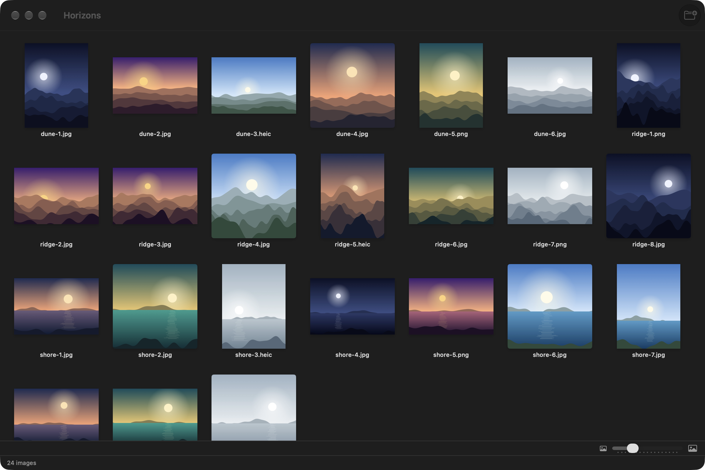
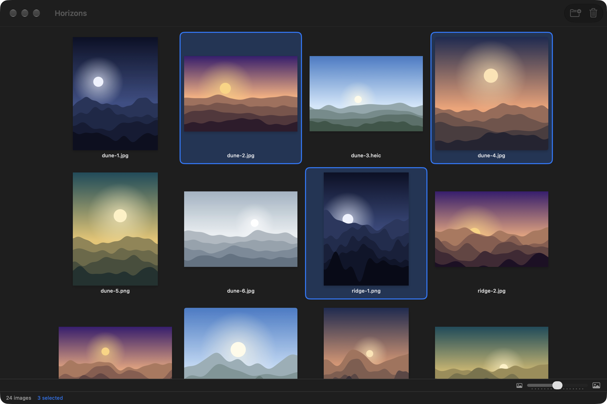
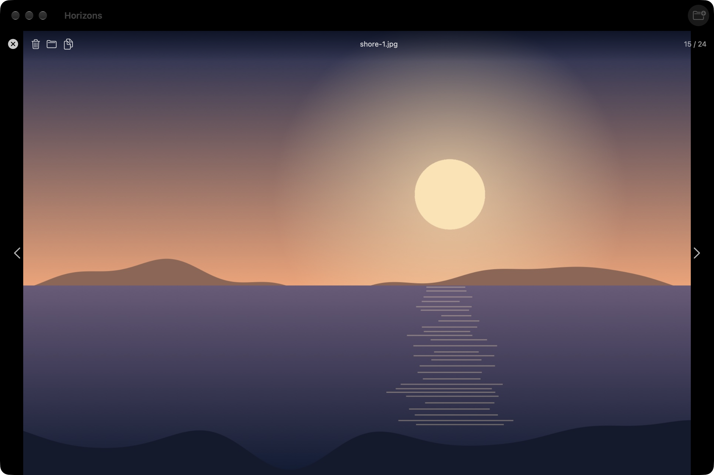
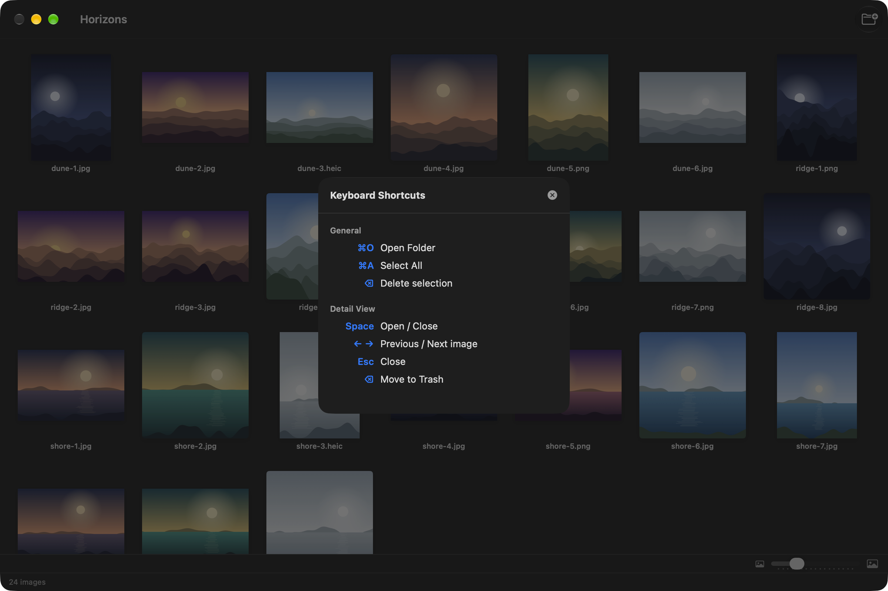

# Planche

[](https://github.com/gwenn-ha-dev/Planche/actions/workflows/ci.yml)
[](./LICENSE)


*🇬🇧 English · 🇫🇷 [Français](./README.fr.md)*

A native macOS app to view, sort and organise your images — a contact sheet for a folder tree.



## Features

- **Recursive browsing**: every image in a folder and its subfolders, in natural order (`shore-2` before `shore-10`).
- **Thumbnail gallery** with a size slider, remembered between sessions.
- **Detail view** with keyboard navigation: ← → to move, Space or Esc to go back.
- **Multiple selection**: ⌘-click, ⇧-click, ⌘A.
- **Delete** to the macOS Trash, **drag and drop** a folder straight into the window, **Show in Finder**, **Copy Image** and **Copy Path** from the context menu.
- Formats: JPG, PNG, GIF, BMP, TIFF, HEIC, HEIF, WebP, AVIF, SVG.
- English and French, following the system language.

| Selection | Detail view |
|---|---|
|  |  |

The keyboard shortcuts are one keystroke away, ⌘/:



## Install

Download **`Planche-<version>.dmg`** from the [latest release](https://github.com/gwenn-ha-dev/Planche/releases/latest), open it and drag Planche onto Applications. The app is signed with a Developer ID and notarized by Apple: it opens with a double click.

To build from source instead:

```sh
git clone https://github.com/gwenn-ha-dev/Planche.git
cd Planche
make package      # build/Planche.app
```

## Usage

Open a folder with ⌘O, or drop one onto the window. Click a thumbnail to select it, double-click it (or press Space) to see it large. ⌫ moves the selection to the Trash, after a confirmation.

## How it works

Planche never modifies your files. It reads a folder tree, shows it, and the only destructive action it offers goes through the system Trash. The app is sandboxed: it reads only the folders you open or drop on it.

## Build

| Command | What it does |
|---|---|
| `make build` | Release build, warnings are errors |
| `make test` | Run the test suite |
| `make run` | Launch the app |
| `make icon` | Regenerate `Resources/AppIcon.icns` |
| `make package` | Build `build/Planche.app` |
| `make sign` | Sign it with a Developer ID, notarize and staple it |
| `make dmg` | Pack the notarized app into a notarized `.dmg` |
| `make shots` | Retake the captures in `docs/img/` |
| `make release-check` | Check that `build/` is publishable |
| `make lint` | Check compliance with the project charter |
| `make help` | List every target |

The pictures in the captures are drawn by `outils/echantillons.swift`, not taken from anyone's photo library.

## Dependencies

None — Apple frameworks only.

## License

MIT © 2026 gwenn-ha-dev — see [LICENSE](./LICENSE).
